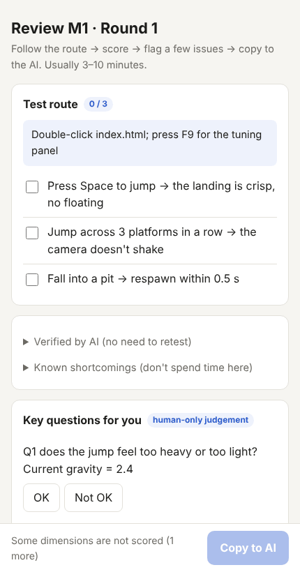

# vibecodingflow

**English** · [简体中文](README.zh-CN.md)

> **A human-in-the-loop workflow skill for AI-built software and games.**
> The AI does the 90%. Your last 10% — feel, taste, trade-offs — becomes a minute of clicking instead of a week of back-and-forth.




A Claude skill (Claude Code / claude.ai) **and** a plain docs template for any agent that reads `AGENTS.md`. Pure Python stdlib, no background processes. **Docs, review panel and script output come in English and Chinese** (`--lang en` is the default, `--lang zh` for Chinese).

## The problems it targets

| Symptom | Cause | What this does |
| --- | --- | --- |
| A fresh AI session treats the design doc as the current state | No memory; intent and reality are mixed | Design vs. current state are separate files; decisions, debts and mismatches each have a home; a ≤15-line status brief is injected at session start |
| The AI says "done", you try it, it's full of problems | Models are optimistic about their own work | The AI can only mark a milestone "awaiting review". **Only a human-signed review card makes it "done"** — enforced by a checker script, a Claude Code Stop hook and a git pre-commit hook |
| You say "feels off", the AI guesses, ten rounds follow | Vague feedback, blind edits | Acceptance baseline + 5-dimension scoring + structured feedback + tuning panel + incremental re-check + circuit breaker |
| Everything runs on the most expensive model | No division of labour | Bounded, machine-verifiable tasks are delegated to Sonnet / Haiku subagents; routing is calibrated from your own stats |
| You don't know what "good" is before the first review | No yardstick | 8 genre baselines (platformer, roguelite, puzzle, tower defense, …) |

## One review round

```
AI self-tests (anything a machine can check; optionally by an independent dk-verifier)
   │
   ▼
AI generates a review card + click panel ──► You: play the 3-minute route → score → flag issues → "copy to AI"
                                                          │
   ┌──────────────────────────────────────────────────────┘
   ▼
AI writes it back to the card and branches on the verdict
   ├─ pass            → you signed → done
   ├─ pass-with-tweaks → AI batches the fixes → next round you only re-check what changed
   └─ rework          → AI batches the fixes → 2 consecutive reworks = change approach (circuit breaker)
```

What you paste back into the chat is structured, so the AI can write it straight into the review card:

```
[Review M1 round 1] Reviewer: Sam  Date: 2026-10-31
Scores: Usable 4  Looks 3  Feel 2  Clarity 4  Engaging 3
Reasons: Feel = the jump is floaty
Key questions: Q1 Not OK (wants it snappier)
Issues:
1.[Feel][High] the jump landing is floaty | wants it crisp
Good: loves the colour palette
Verdict: Rework (matches suggestion)
```

(Scores: Usable / Looks / Feel / Clarity / Engaging, 1–5. Rule: rework if any score ≤2 or any high-severity issue; pass-with-tweaks if any =3 or any medium issue; otherwise pass. You can override, but must write why.)

## Size it, interview, then build

Not everything needs the full flow: **tier S** (≤3 files, no design trade-off) is just change, verify, commit with no docs; **tier M** uses the lean set; only **tier L** adds `--full --agents --hooks`. At kick-off the AI interviews you in rounds (a recommended answer with every question, facts looked up rather than asked) and lands the answers in the matching DESIGN sections; building starts only when no branch is open and you say the shared understanding is reached (question bank in `references/en/grill.md`; the `grill-me` skill is used for the mechanics if installed). Planning cuts tasks by complete operation chains and gives every task a check; `check_docs.py --progress` shows task progress bars at any time, and `--brief` includes them too.

## Four key capabilities

1. **Human review loop (core).** Review cards, a phone-friendly click panel, suggested verdict rules, `--stats` for first-pass rate and average rounds.
2. **Genre acceptance baselines.** `init.py --genre platformer` writes "what a 4/5 looks like for this genre", starting feel parameters, common rework points and a sample test route into your project. Eight presets: `platformer` `roguelite_survivors` `puzzle` `tower_defense` `idle_incremental` `minimal_management` `top_down_action` `web_app_tool`. They are starting points — calibrate after the first review.
3. **Delegation layer (Claude Code).** `init.py --agents` installs four subagents with explicit model, permissions and report format:

   | Subagent | Model | Job |
   | --- | --- | --- |
   | `dk-implementer` | sonnet | Implement one well-bounded task |
   | `dk-verifier` | sonnet | Independent cold-context verification; cannot edit source |
   | `dk-scribe` | haiku | Mechanical transcription: panel text → review card, feedback_log |
   | `dk-reviewer` | opus | Root-cause analysis after the circuit breaker, high-risk changes, pre-release audit |

   A task is delegated only if it passes a four-question test (clear goal, bounded scope, machine-verifiable, no subjective judgement). Two failures → escalate. Status and sign-off are never delegated. `check_docs.py --stats` reports first-pass rate **per route**, so your own data decides who gets what.
4. **Enforcement & adoption.** `init.py --hooks` installs a Claude Code Stop hook (blocks finishing while docs have ERRORs, at most 2 blocks per identical error set to avoid loops), a SessionStart hook (status brief) and a git pre-commit hook. `adopt.py` scans a half-finished project (engine, structure, testability health check, debt drafts); the AI drafts `CURRENT_STATE` with every inference marked "to be confirmed", and you sign off on the M0 baseline card.

## Install

**Claude Code (personal):**
```bash
git clone https://github.com/williamchanu013-pixel/ai-dev-kit ~/.claude/skills/vibecodingflow
```
**Claude Code (project, shared with team):** put it in `.claude/skills/vibecodingflow/`.
**claude.ai:** zip the folder, upload under Settings → Capabilities → Skills (no subagents or hooks there; everything else works).
**Other agents (Codex, Cursor, …):** no skill mechanism needed — run `init.py` once, then tell the agent "read AGENTS.md first".

## Usage

```bash
# New project. Games: --genre or --game. Claude Code users: add --agents --hooks
python scripts/init.py ./my-game --name "My Game" --genre platformer --agents --hooks   # add --lang zh for Chinese docs
python scripts/init.py --genre list

# Inside the project
python docs/dev/tools/new_review.py M1                           # create a review card
python docs/dev/tools/build_panel.py docs/dev/reviews/M1_r1.md   # build the click panel (double-click the .html)
python docs/dev/tools/check_docs.py                              # run the rules
python docs/dev/tools/check_docs.py --brief                      # ≤15-line status brief
python docs/dev/tools/check_docs.py --progress                   # task progress bars per milestone
python docs/dev/tools/check_docs.py --stats                      # rework + delegation stats
python docs/dev/tools/adopt.py .                                 # adopt an existing project
```

With the skill installed you can just tell Claude: "start a platformer project", "milestone done, let me review", "I played it — the jump is floaty", "adopt this half-finished project".

See [`examples/sample-platformer/`](examples/sample-platformer/) (English) and [`examples/sample-platformer-zh/`](examples/sample-platformer-zh/) (Chinese) for projects with two filled-in review rounds (**illustrative data, not from a real project**).

## Design trade-offs

- **Light: conventions plus scripts, no heavy orchestration.** One folder, no daemon. Only four subagents, with short descriptions (subagent descriptions count toward startup token budget).
- **Few, hard documents.** 14 documents + 2 templates in the lean setup; each answers one question; stale ones get archived.
- **Humans decide.** "Done" is decided only by a human; the AI suggests severity, the human sets it.
- **Relation to similar projects:** spec-driven tools (Spec Kit, OpenSpec, BMAD) cover *requirements → implementation*; engine-knowledge skills cover *how the API works*; pre-code process skills cover *what to settle before coding*; multi-agent studios cover *pipeline roles*. This kit covers **after implementation: how a human reviews fast and accurately, how the next AI session picks up, and which work goes to which model.** It stacks with them rather than duplicating them.

## Verified vs. not verified

- 54 unit/end-to-end tests (`python -m unittest discover -s tests`), CI on Ubuntu and Windows with Python 3.10 / 3.12 / 3.13 (also run locally on 3.9). They include a real `git commit` being blocked/allowed by the pre-commit hook, and a full English review cycle.
- The Stop and SessionStart hooks were exercised in a real headless Claude Code session (v2.1.314): the status brief was injected, marking a milestone "done" without a signed card was blocked, and the loop guard released after 2 blocks. Other versions and interactive mode were not individually tested.
- **Not validated on a large real project.** Verdict thresholds, routing tables and genre parameter starting points are experience-based defaults — calibrate them with your own data (≥10 tasks per route before trusting delegation stats). The English docs were AI-translated and checked for structural parity with the Chinese originals, so wording may be less natural than a native writer's — issues and PRs welcome. Genre presets cover 8 types; `adopt.py`'s health check is keyword-based and can produce false positives/negatives.

## License

[MIT](LICENSE)
