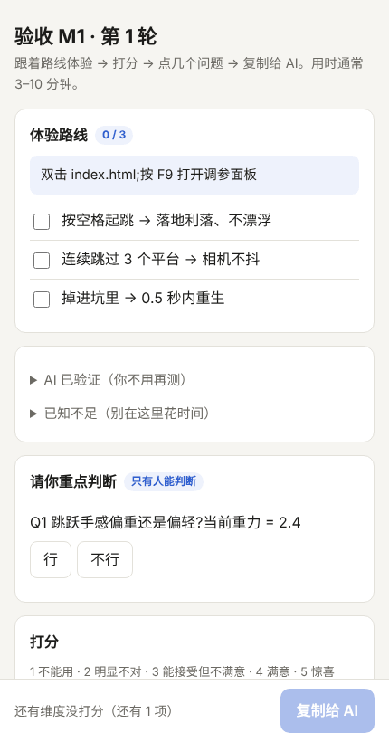

# vibecodingflow

[English](README.md) · **简体中文**



> **面向 AI 开发的"人在回路"工作流 skill。** AI 干 90%，你最后 10% 的判断（手感、品味、取舍）变成一分钟的点选，而不是一周的来回修改。
> 既是 Claude skill（Claude Code / claude.ai），也是任何读取 `AGENTS.md` 的 AI 工具都能用的文档模板。纯 Python 标准库。

适合 vibe coding 的游戏、网站、工具项目。**文档、面板和脚本输出同时支持中文和英文**（`--lang zh` / `--lang en`）。

## 它解决什么问题

AI 写代码很快，但项目一长就会出现这几件事：

| 症状 | 原因 | 这里的做法 |
| --- | --- | --- |
| 新对话里的 AI 不知道之前定过什么，把设计当成现状 | 没有记忆，意图和现实混在一起 | 设计 / 现状分开写；决策、欠账、偏差各有位置；新会话自动注入 ≤15 行状态摘要 |
| AI 说"完成了"，你一试全是问题 | AI 对自己的活天然乐观 | AI 最多标「待验收」，**必须人签字才算完成**；脚本、hook、git pre-commit 三层强制 |
| 你说"有点怪"，AI 猜，来回改十轮 | 反馈模糊、目标不清、修改盲目 | 验收基准 + 五维打分 + 结构化反馈 + 调参面板 + 增量复验 + 熔断 |
| 所有活都用最贵的模型干，主会话上下文很快被执行细节塞满 | 没有分工 | 边界清楚、能机器验证的任务分派给 Sonnet / Haiku 子代理，并用你自己的数据校准路由 |
| 不知道"好"的标准，第一次验收全凭感觉 | 没有尺子 | 8 个类型的验收基准预设（平台跳跃、肉鸽、解谜、塔防……） |

## 一轮验收长什么样

```
AI 自测（机器能查的先查；可交给独立的 dk-verifier）
   │
   ▼
AI 生成验收卡 + 点选面板 ──► 你：跟着 3 分钟路线体验 → 打分 → 标问题 → 点「复制给 AI」
                                        │
   ┌────────────────────────────────────┘
   ▼
AI 写回验收卡，按结论分流
   ├─ 通过        → 你已签字 → 完成
   ├─ 小改后过    → AI 合并改一批 → 下一轮你只复验改过的几条
   └─ 返工        → AI 合并改一批 → 连续 2 轮返工就换方案（熔断）
```

你复制给 AI 的内容大概是这样，机器可以直接解析：

```
【验收 M1 第1轮】验收人：小陈 日期：2026-10-31
分：能用4 看着3 手感2 清晰4 想继续3
理由：手感=跳跃太飘
重点判断：Q1 不行(想要利落)
问题：
1.[手感][高] 跳跃落地太飘 | 想要利落
好的：配色很喜欢
结论：返工（与建议一致）
```

## 先分档，再追问，再做

不是所有事都要走完整流程：**S 小改**（≤3 个文件、没有设计取舍）直接改、验证、提交，不建文档；**M 功能**走精简版；**L 大型**才加 `--full --agents --hooks`。立项时 AI 用分轮追问（每题带推荐答案，能查的事实自己查）把范围问清楚，答案直接落进 DESIGN 对应章节，问到没有分支、你说“共识达成”才开工（题库见 `references/zh/grill.md`，装了 `grill-me` skill 会用它跑追问）。计划阶段按“完整操作链”拆任务，每个任务写明验证方式；`check_docs.py --progress` 随时看任务进度条，`--brief` 摘要里也有。

## 四个重点能力

**1. 人类验收闭环（核心）**：验收卡 + 手机可用的点选面板；建议结论规则（≤2 分返工、=3 分小改后过、全部 ≥4 分通过，人可覆盖但要写原因）；`--stats` 看首轮通过率和平均轮数。

**2. 类型验收基准预设**：`init.py --genre platformer` 把该类型"4 分长什么样"、手感参数起点、常见返工点、体验路线示例写进项目。现有 8 个：`platformer` `roguelite_survivors` `puzzle` `tower_defense` `idle_incremental` `minimal_management` `top_down_action` `web_app_tool`。预设是起点，首轮验收后按你的口味校准。

**3. 分派层（Claude Code）**：`init.py --agents` 安装 4 个子代理，每个带明确的模型、只读 / 可写权限和汇报格式：

| 子代理 | 模型 | 干什么 |
| --- | --- | --- |
| `dk-implementer` | sonnet | 实现一个边界清楚的任务 |
| `dk-verifier` | sonnet | 冷上下文独立验证，不改源码 |
| `dk-scribe` | haiku | 机械转录：面板文本写回验收卡、feedback_log |
| `dk-reviewer` | opus | 熔断后的根因分析、高风险改动、交付前审计 |

只有通过"四问"（目标清楚、范围有界、能机器验证、不涉及主观判断）的任务才委派；失败 2 次就升级；状态和签字永远不分派。计划任务表里记"路由"和"结果"，`check_docs.py --stats` 按路由统计一次通过率，**用你自己的数据决定哪些活交给哪个模型**。

**4. 强制与接手**：`init.py --hooks` 安装 Claude Code 的 Stop hook（docs 有 ERROR 时拦住收工，同一错误最多拦 2 次防死循环）、SessionStart hook（注入状态摘要）和 git pre-commit。`adopt.py` 扫描做到一半的项目（引擎与版本、结构、可验收性体检、欠账草稿），AI 据此写 CURRENT_STATE，推断处标「待确认」，由人在 M0 接手基线的验收卡上签字确认。

## 安装

**Claude Code（个人）**

```bash
git clone https://github.com/williamchanu013-pixel/ai-dev-kit ~/.claude/skills/vibecodingflow
```

**Claude Code（项目内，团队共享）**：放到项目的 `.claude/skills/vibecodingflow/`。

**claude.ai**：把整个文件夹打成 zip，在 设置 → 能力 → Skills 里上传（没有子代理和 hook，其余功能可用）。

**其他 AI 工具（Codex、Cursor 等）**：不需要 skill 机制。运行一次 `init.py`，模板、脚本和细则文档会拷进你的项目，之后对 AI 说"先读 AGENTS.md"即可。

## 使用

```bash
# 新项目；游戏用 --genre 或 --game；Claude Code 用户加 --agents --hooks
python scripts/init.py ./my-game --lang zh --name "我的游戏" --genre platformer --agents --hooks
python scripts/init.py --genre list --lang zh                 # 查看类型预设（--lang 默认 en，中文项目请加 --lang zh）

# 以下在项目目录里运行
python docs/dev/tools/new_review.py M1                       # 生成验收卡
python docs/dev/tools/build_panel.py docs/dev/reviews/M1_r1.md   # 生成点选面板（双击打开）
python docs/dev/tools/check_docs.py                          # 检查规则
python docs/dev/tools/check_docs.py --brief                  # 15 行状态摘要
python docs/dev/tools/check_docs.py --progress               # 按里程碑看任务进度条
python docs/dev/tools/check_docs.py --stats                  # 返工与分派统计
python docs/dev/tools/adopt.py .                             # 接手已有项目：扫描事实清单
```

装了 skill 的话，直接对 Claude 说"帮我开一个平台跳跃游戏项目""这个里程碑做完了，给我验收""我试玩了，跳跃太飘""帮我接手这个做到一半的项目"，它会按流程走。

## 目录

```
vibecodingflow/
├── SKILL.md                  # 入口：场景路由 + 铁律（英文；Claude 会按用户语言回复）
├── references/{en,zh}/       # 两种语言各一套，文件同名
│   ├── grill.md              # 立项追问：题库、答案落到哪、工具/游戏补充
│   ├── human-loop.md         # 验收闭环细则（打分、结论规则、面板格式、参数化、熔断、度量）
│   ├── delegation.md         # 分派：路由准则、任务卡、升级阶梯、校准
│   ├── game-layer.md         # 游戏层（灰盒优先、手感参数、F8/F9 最小实现、试玩方法）
│   └── guide.md              # 给人看的完整说明
├── assets/
│   ├── review_panel.html     # 点选式验收面板模板
│   ├── agents/{en,zh}/       # 4 个 Claude Code 子代理定义
│   ├── genres/{en,zh}/       # 8 个类型验收基准预设
│   └── templates/{en,zh}/{core,game,full}/   # 文档骨架
├── scripts/                  # 纯 Python 标准库
│   └── init.py  new_review.py  build_panel.py  check_docs.py  adopt.py  dk_hook.py  dk_common.py
├── examples/sample-platformer/      # 英文示例项目(数据为演示,非真实项目)
├── examples/sample-platformer-zh/   # 中文示例项目
└── tests/test_kit.py         # 54 个测试；python -m unittest discover -s tests
```

## 设计取舍

- **轻量，靠约定和脚本，不靠重型编排。** 一个文件夹，没有后台进程。子代理只有 4 个，描述保持简短（子代理描述会占启动 token 预算）。
- **文档少而硬。** 精简版 14 份文档 + 2 个模板，每份只回答一个问题；过期就归档。
- **人拍板。** 完成与否只由人决定；严重度由人定，AI 只给建议。
- **与同类的关系：** 规格驱动类（Spec Kit、OpenSpec、BMAD）管"需求 → 实现"；引擎知识类（如 awesome-gamedev-agent-skills）管"API 怎么用"；开工前流程类（如 make-game）管"写代码前先定好什么"；多 agent 工作室类管"流水线分工"。这里管的是**实现之后：人怎么又快又准地验收，下一个 AI 怎么接得上，以及哪些活该交给哪个模型**。可以和它们叠加使用，这里不重复它们的内容。

## 已知局限

- 没有在大规模真实项目上验证过；`examples/` 里的验收数据是演示数据。`--stats` 和分派统计需要积累数据才有参考价值（每个路由 ≥10 个任务）。
- 建议结论的阈值（≤2 返工、=3 小改）、路由表的"谁做什么"、类型预设里的参数起点，都是经验值，请用你自己的数据校准。
- 子代理、hook 是 Claude Code 特性。hook 按官方文档实现，并在真实的 Claude Code 无头会话（2.1.314）里验证过：开工摘要会注入，Stop 会拦住「无签字就完成」，同一错误拦 2 次后放行；其他版本和交互模式没有逐一测过。
- 类型预设只有 8 个；`adopt.py` 的体检是关键词扫描，会有误报和漏报。
- 英文版文档由 AI 翻译并经过结构一致性测试，措辞可能不如母语者自然，欢迎提 issue / PR 改进。

## License

[MIT](LICENSE)
